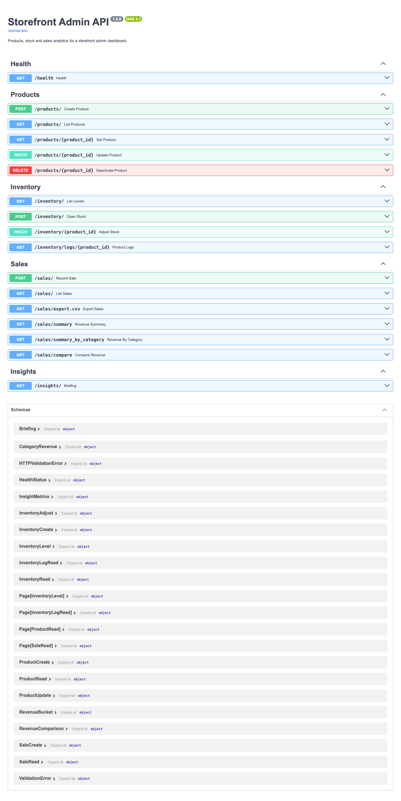
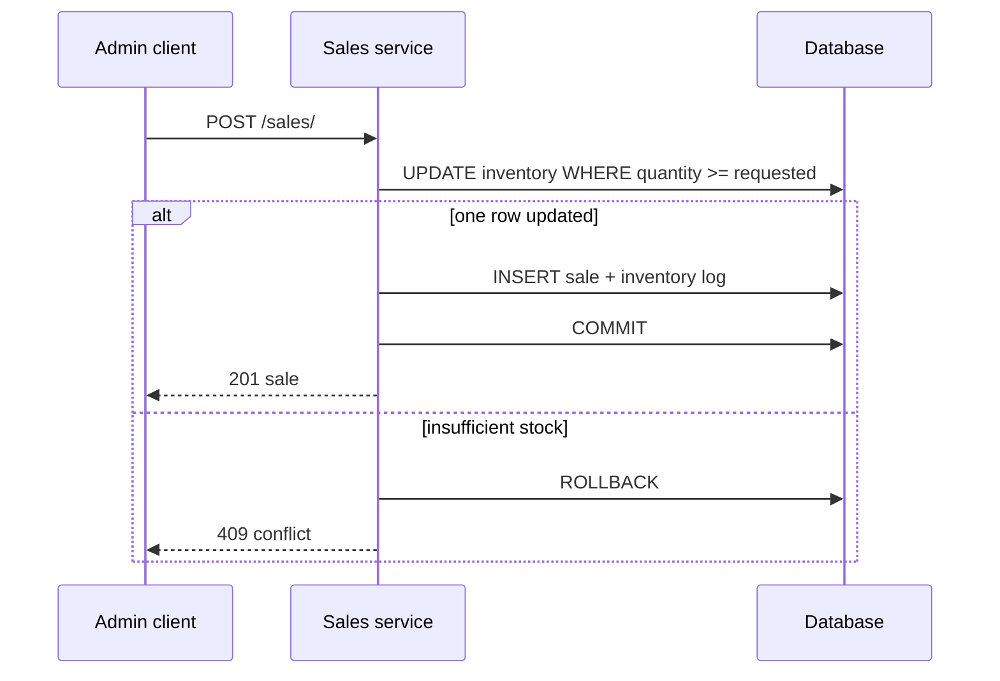

# Storefront Admin API

Admin backend for a small shop: products, stock levels, sales and revenue reports. It runs on FastAPI with async SQLAlchemy. MySQL is the deployment database. Without `DATABASE_URL`, the API uses a local SQLite file; the native demo needs only Python 3.11+ and the packages below.

Recording a sale prices it from the product, takes the quantity out of inventory and writes an inventory log entry, all in a single transaction. Stock is decremented with a conditional SQL update, so two requests cannot both sell the last unit. Insufficient stock returns 409; no sale or stock log is committed for that request.



A [recorded HTTP example](docs/api-demo.json) creates a demo product with 12 units,
sells two through `POST /sales/` (201), and reads back 10 units. The data is synthetic;
the requests and responses come from the local API.

## Setup

```bash
python3 -m venv .venv && source .venv/bin/activate
pip install -r requirements-dev.txt
python -m demo_data          # seeds a few products, stock and sales
uvicorn app.main:app --reload
```

Swagger docs are at http://localhost:8000/docs and `GET /health` also checks the database connection.

To use MySQL, copy `.env.example` to `.env` and set `DATABASE_URL` (for example `mysql+aiomysql://...`).

## Endpoints

- Products: `POST /products/`, `GET /products/` (search, category, is_active, paging), `GET`, `PATCH`, `DELETE /products/{product_id}` (delete is soft, it sets `is_active` to false)
- Inventory: `GET /inventory/` (with low-stock filtering), `POST /inventory/`, `PATCH /inventory/{product_id}` for adjustments with a reason, `GET /inventory/logs/{product_id}`
- Sales: `POST /sales/`, `GET /sales/` with date, product and category filters, `GET /sales/export.csv`
- Reports: `GET /sales/summary` (by day, week, month or year), `GET /sales/summary_by_category`, `GET /sales/compare` (current period against the previous one)
- `GET /insights/` returns a short text summary of revenue and low stock plus the raw numbers

List endpoints return `{items, total, limit, offset}`. Errors come back as `{"error": {"code", "message", "details"}}`.

The schema is four tables (products, inventory, sales, inventory_logs). It's created with `create_all` on startup, and `schema.sql` and `ERD.png` document it.

## Configuration

Everything is optional, see `.env.example`. Useful ones: `ADMIN_API_KEY` (if set, write requests need an `X-API-Key` header), `LOW_STOCK_THRESHOLD`, `DEFAULT_PAGE_SIZE`, `MAX_PAGE_SIZE`, `SQL_ECHO`.

`/insights/` uses a rule-based text generator by default. Setting `INSIGHT_PROVIDER=anthropic` with `ANTHROPIC_API_KEY` (and installing `requirements-ai.txt`) uses the Anthropic API to write the text instead, and it falls back to the rules if that fails.

## Tests

```bash
pytest
ruff check .
```

Most tests use in-memory SQLite. The last-unit regression uses a temporary file database
and independent sessions: two simultaneous requests produce one sale, one conflict,
one stock movement and zero remaining units. Run the suite with `python -m pytest`.
MySQL deployment behavior should also be checked against your configured server.



New databases also enforce `quantity >= 0` with a check constraint. `create_all`
does not alter existing tables. For an existing MySQL 8.0.16+ database, back it up,
resolve any negative quantities, then apply
[`migrations/001_inventory_nonnegative.sql`](migrations/001_inventory_nonnegative.sql).
The conditional update protects the API before that migration is applied.

## TODO

- Add migrations instead of relying on `create_all`
- Support refunds or corrections for sales
- Stream the CSV export instead of building it in memory

## Author

[**Muhammad Nadeem**](https://github.com/dev-mnadeem)
